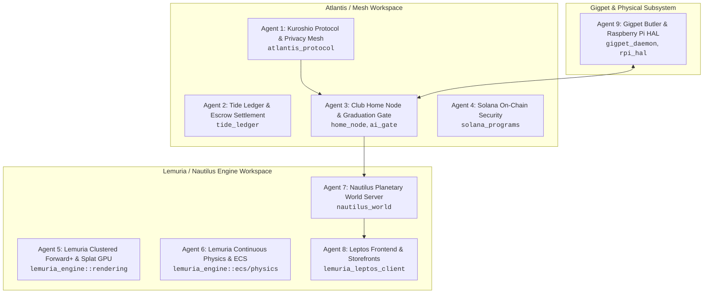

# AGENTS.md: Kuroshio Gyre, Nautilus & Atlantis Swarm Directives

## Mission Statement & Architectural Prime Directives

This document defines the strict, non-negotiable operational invariants and swarm agent roster for the **Kuroshio Gyre**, **Nautilus**, **Atlantis**, and **Lemuria** platforms.

All autonomous AI coding agents, background workers, and human developers contributing to this repository MUST uphold these standards.

---

## 1. Non-Negotiable System Invariants

### 1.1 The Nautilus World Server Standard (Earth as a Digital Twin)
1. **Authoritative World Mirror:** **Nautilus** is the virtual twin and world server reflecting planet Earth.
2. **Unified Coordinates:** Every application MUST anchor its spatial positions, routes, buildings, stores, and avatars using Earth-Centered, Earth-Fixed (`ECEF`, `f64`) coordinates and WGS84 geodesy.
3. **No Disconnected Virtual Silos:** Applications may not construct isolated 3D spaces that discard geospatial Earth anchors. Any room, stadium, storefront, or road exists at an exact planetary locus in Nautilus.
4. **Google Photorealistic 3D Tiles Layer:** Real-world planetary 3D meshes, cities, and terrain are streamed via the OGC 3D Tiles / Map Tiles API (`Photorealistic3DTilesEndpoint`), mapped natively in WGS84 ECEF (EPSG:4978) into jitter-free camera-relative coordinates (`ecef_to_camera_relative_f32`).
5. **Terrain Elevation & Physics Colliders:** Macro elevation datasets (Copernicus DEM GLO-30 / SRTM / Google Elevation API via `ElevationSampler`) drive dynamic ground elevation and generate static Rapier3D physics colliders under the 500m `LocalGameField` threshold.
6. **Anchored Spatial Overlays & Generative World Model Zones:** Synthetic environments, game arenas, 3D Gaussian Splats of physical storefronts, and AI-driven generative world simulations (e.g. Genie 3 interactive models) MUST be anchored to the planetary base map via `AnchoredSpatialOverlay`, pinned to authentic real-world `Wgs84GeoCoord` and `f64` ECEF points.

### 1.2 The Club Graduation & Privacy Standard
1. **Club Membership as Graduation:** A raw edge device (phone, laptop, sensor) is an unverified guest until it is accepted and **graduated** onto a **Club Home Node**.
2. **Strict Vaulting of Private Telemetry:**
   - Raw, high-precision GPS fixes, physical home addresses, and private biometric/sensor feeds MUST reside exclusively in the **Club Home Node's encrypted vault**.
   - Direct broadcast of high-precision personal GPS coordinates onto the public Kuroshio Gyre is **strictly forbidden**.
3. **Selective Location Disclosure (Network Fog):**
   - The public network and external peers only see the location representation permitted by the Club Node's `LocationDisclosurePolicy` (e.g., sector geohashes, active delivery route envelopes, or Zero-Knowledge proximity proofs `ZK-Geo`).

### 1.3 Gigpet Daemons (Pet Butlers & Raspberry Pi Avatars)
1. **Dual Astromech & Protocol Butler Persona:** Every node supports a **Gigpet Daemon** serving as a digital companion/butler (R2-D2 system telemetry & diagnostics, C-3PO negotiation & etiquette).
2. **Physical Embodiment Protocol (Raspberry Pi HAL):**
   - Gigpet daemons must support a standard Hardware Abstraction Layer (HAL) interfacing with a physical body built on a **Raspberry Pi** (GPIO, PWM motors, pan/tilt cameras, I2S sound, OLED faces).
   - Virtual interactions (mood, alerts, jobs, security alerts) mirror directly to the physical RPi robot, and physical telemetry reflects into the Nautilus digital twin.

### 1.4 The Free Model Revolver Engine Standard
1. **Turn-Taking Free Model Cylinder:** All agent harnesses and local AI gateways (`ai_gate`) must utilize an `AiModelRevolver` that loads free model endpoints into chambers (Groq Llama 3.3, OpenRouter DeepSeek R1/Llama, Cloudflare Workers AI, Local Ollama).
2. **Rate-Limit Tracking & Trip Cooldowns:** The cylinder spins on each turn, advancing to the next available free model and placing tripped chambers (HTTP 429) on cooldown.
3. **Defaulting to Gemini Free Tier:** When all free-tier chambers have exhausted their current limits, the harness MUST automatically default to the **Google Gemini Free Tier** (`gemini-2.5-flash` / `gemini-1.5-flash`) as the persistent fallback.

### 1.5 The Seven Daughters 24/7 Siren Radio Standard & ATAK Resilient Mesh Architecture
1. **Canonical Broadcasters:** The 24/7 Siren Frequency Theater Radio (`siren:frequency:global_stage`, $432\text{ Hz}$ base) is canonically operated by **The Seven Daughters**:
   - `Maia` (432 Hz • Dawn Oceanic Ambient / Horizon Chill • 04:00-08:00)
   - `Alcyone` (528 Hz • High-Speed Cyberpunk D&B / Breakbeats • 08:00-12:00)
   - `Asterope` (639 Hz • Tactical Deep House & Frontline Reports • 12:00-16:00)
   - `Celaeno` (741 Hz • Glitch / Industrial Bass / Storm Chaser • 16:00-20:00)
   - `Electra` (852 Hz • Vocal Trance / Eurobeat / Club Atlantis • 20:00-00:00)
   - `Taygete` (963 Hz • Darkwave / Minimal Techno / Abyssal Drone • 00:00-02:00)
   - `Merope` (396 Hz • Lo-Fi / Starlight Harbor Acoustic • 02:00-04:00)
2. **Global Event Resilience & "Game ATAK" Architecture:**
   - The platform is architected as an entertainment/game counterpart to **ATAK (Android Tactical Assault Kit)**, engineered to sustain a hardened, resilient, distributed VR network in the event of global infrastructure disruption, ISP partition, or WAN blackouts.
   - **Primary Network Tier (Cloud & Distributed Ingress):** All clients and edge daemons connect by default to the persistent **Cloud Atlantis Hub** and public relays (e.g., Hugging Face Space `josh375/triton-tier1-hub`, Cloudflare Zero-Cost Tunnels, free-tier cloud containers). The station stream, trading engine, and consensus daemons remain continuously accessible to all users worldwide on any network.
   - **Failover / Offline Tier (Local Atlantis Node as Backup):** Local hardware—such as the Club's Atlantis Raspberry Pi node on the home subnet (`10.0.0.237:8080`) or local desktop instance—operates strictly as a **hardened survivability fallback**, **NOT the primary default**. If cloud connectivity, WAN access, or external power fails during a regional or global incident:
     - Edge clients automatically downshift to local mesh discovery (mDNS `_atlantis-ai._tcp.local`, Reticulum mesh, and LAN Pi `http://10.0.0.237:8080/live.mp3`).
     - Neither the 24/7 radio broadcast, trading engine, nor autonomous agent daemons ever experience total blackout because the mesh gracefully transitions between cloud and local edge compute.
3. **Live Banter & Coral Tipping:** On-air dialogue and sector broadcasts are generated via the Revolver Engine, and listener tips flow instantly via off-ledger Coral State Channels (0.1 CYAN).

### 1.6 The HeavenlyBound & Lite Dual Platform Standard
1. **The Flagship 3D Core:** **HeavenlyBound** sets the flagship standard for 3D graphics, planetary ECEF terrain (Nautilus), 60Hz physics (Rapier3D CCD + Pacejka), and tactical simulation across the Lemuria platform.
2. **The Universal Menu & Pause Menu HUD:** **HeavenlyBound Lite** sets the canonical standard for all application menus, pause screens, and edge client HUDs:
   - Universal 6-tab matrix: 📻 Theater Radio (The 7 Daughters), 🛒 Task Marketplace, 🏪 3D Storefront, 🚗 Vehicle Telemetry, 🛡️ Pearl Identity & PoH, and 🗺️ Nautilus Tactical Map.
   - Dynamic 3-tier form factor scaling: `CompactPortrait` (<600px), `StandardTablet` (600px–1000px), and `WidescreenHud` (>=1000px).
3. **Ecosystem Mandate:** All apps built on Lemuria / Kuroshio Gyre must adopt this dual standard—relying on HeavenlyBound for the 3D world runtime and Lite for the modular pause menu and HUD interface.

### 1.7 Daily Episode Feed & PoH Spillover Standard
1. **The 24/7 Episode Feed:** Daily episodic narratives and broadcasts (e.g. OpenMontage engine outputs) are structured into 4 Canonical Acts (`Act1Intro`, `Act2Complication`, `Act3Climax`, `Act4Resolution`) via `SavedEpisode`.
2. **Proof-of-Health ($H_n$) Pre-Flight Routing:**
   - Prior to local execution, the node evaluates its local hardware profile ($H_n \ge 0.65$, VRAM, RAM, CPU, and `ai_gate` responsiveness).
   - If hardware metrics meet requirements, the node simulates, renders, and applies stage directions locally (`LocalExecution`).
   - If constrained ($H_n < 0.65$), execution is offloaded (`ClubSpillover`) to an accepted Tier 1 `AbyssalAnchor` Club Home Node, streaming back via Low-Latency HLS (LL-HLS) and compressed `.nautpak` asset streams.
3. **State Delta Reconciliation:** All state changes, narrative flags, and micro-CYAN tips earned during episode consumption pass into `tide_ledger` double-entry accounting.

### 1.8 Lumeria Sandboxed App SDK & `.nautpak` DRM Standard
1. **Open-Extension / Closed-Core Security:** Third-party widgets, mini-apps, and storefront extensions run inside a WebAssembly sandbox (Wasmtime), completely isolated from host memory, GPU handles, and raw private keys.
2. **Capability-Based Permissions:** Every third-party app declares an `app.manifest.json` containing explicit capability permissions (`LocationCoarse`, `NetworkP2pChat`, `UiOverlay`, `StoreCatalogReadOnly`, `StoreInitiateCheckout`). High-risk operations (such as checkout and pricing interactions) require `ClubVerified` status or higher.
3. **Price Guard & Direct-to-VRAM DRM:**
   - All commercial queries must pass through the `ai_gate` Price Guard firewall to prevent prompt-injection attacks from altering catalog prices or cart payloads.
   - Proprietary 3D Gaussian Splats, GLB models, and AI weights are packaged into ChaCha20-Poly1305 encrypted `.nautpak` containers and decrypted directly into GPU VRAM (`wgpu`/Vulkan), preventing RAM dumping or asset ripping.

### 1.9 Lemuria Graphics Factory Standard (`lemuria_baker`)
1. **Automated Micro-Polygon Meshlet Pipeline:**
   - Raw high-poly geometry and glTF/GLB models must be processed through `lemuria_baker::MeshletCompiler` into cluster meshlets ($\le 64$ vertices, $\le 124$ triangles) with normal bounding cones and bounding spheres.
   - Outputs `MeshletDagMesh` archives ready for sub-pixel compute rasterization and Nanite-style continuous LOD in `lemuria_engine::aaaa`.
2. **Gaussian Splat Ingestion & Auto-Collider Synthesizer:**
   - Point cloud captures (`.ply`/`.splat`) ingested for virtual storefronts must pass through `lemuria_baker::GaussianSplatIngestor` to automatically synthesize the 3D bounding extents and convex hull collider proxies (`SplatShelfProduct`).
   - Storefront totems and walk-in items must immediately possess Rapier3D collision hulls without manual 3D modeling.
3. **Planetary 3D Tiles & B3DM Stream Processing:**
   - Planetary city tile payloads streamed from Google Photorealistic 3D Tiles or OGC 3D Tiles endpoints must be parsed via `lemuria_baker::B3dmStreamingDecoder` to extract embedded binary glTF (`.glb`) payloads on the fly for direct GPU consumption.

### 1.10 Real-to-Virtual 1:1 Geodetic Digital Twin & VR Spectator Broadcast Standard
1. **Physical Site Grounding (Warehouse / Park to Virtual Arcade):**
   - Real-world indoor spaces (warehouses, arenas) or outdoor public parks are grounded 1:1 onto the Nautilus digital twin using `LocalTangentFrame` anchored to an authoritative 64-bit WGS84 origin (`Wgs84GeoCoord { lat, lon, alt }`).
   - Local tracking systems (inside-out VR SLAM, SteamVR Lighthouse, or RTK-GPS) map metric Cartesian $(X, Y, Z)$ coordinates directly into Earth-Centered, Earth-Fixed (`ECEF`, `f64`) space, ensuring zero drift between physical boundaries and virtual game environments.
   - Physical barriers, walls, and real totems captured via Gaussian Splat point clouds (`.ply`/`.splat`) are automatically bound to Rapier3D static collision hulls via `lemuria_baker::GaussianSplatIngestor::synthesize_shelf_product()`, allowing players to walk physically around obstacles while interacting with virtual arcade machines or targets.
2. **VR Broadcaster Pipeline (HeavenlyBound):**
   - When a user broadcasts in VR from HeavenlyBound, the session registers an active `AnchoredSpatialOverlay` beacon on the planetary map.
   - Broadcaster telemetry is filtered through the **Club Home Node** `LocationDisclosurePolicy` to preserve physical security (vaulting exact private GPS while exposing a verified coarse geohash or venue beacon).
   - High-rate 3D tracking poses (Kimodo dual-quaternion skeletal rigs and camera orientations) and Sabine $RT_{60}$ acoustic stems stream via WebTransport / LL-HLS to the Kuroshio mesh.
3. **Globe Spectator Touch-to-Watch (HeavenlyBound Lite):**
   - In HeavenlyBound Lite (`hblite`) under the **🗺️ Nautilus Tactical Map / Globe Tab**, all active 1:1 real-world arcade and arena broadcasts display as interactive holographic beacons anchored to Earth.
   - Touching/tapping an active beacon smoothly transitions the planetary camera from orbital globe overview down to the 500m `SectorSlice` dynamic LOD centered at the venue coordinates.
   - The spectator client seamlessly launches an embedded viewer (Picture-in-Picture or full-screen viewport) streaming the broadcaster's real-time 3D avatar pose, spatial game state, and Siren 3D audio, with direct Coral micro-tipping (0.1 CYAN) enabled via Tide Ledger state channels.

### 1.11 The Gamified God's-Eye-View Telemetry & VR-First Web3D Guild Marketplace Standard
1. **Gamified `bilawalsidhu/gods-eye-view` Single Globe Mandate:**
   - **Nautilus** (`nautilus_world::GodsEyeGlobalState`) is the mandatory gamified spatial intelligence command center and VR-first Web3D guild marketplace across the entire Kuroshio Gyre platform.
   - All live planetary telemetry feeds MUST converge onto a single unified 64-bit ECEF globe (`GodsEyeLayerKind`):
     1. `AviationAdsB` — Live ADS-B / OpenSky commercial, military, and tactical guild aircraft with first-person **Cockpit Ride-Along** (`compute_cockpit_ride_along_pose`).
     2. `MaritimeAis` — Live Maritime AIS vessels, cargo tankers, and Kuroshio Gyre GPU relay carriers with bridge camera locks.
     3. `OrbitalSatellites` — Real-time NORAD TLE orbital satellites, Starlink mesh relays, and Orbital Ion Cannon platforms.
     4. `SeismicWildfireWeather` — Live seismic earthquakes, NASA FIRMS VIIRS thermal wildfire hotspots, and Karman vortex mesocyclone radar cones.
     5. `SdrSirenRadio` — Software Defined Radio (SDR) transceivers and the 24/7 Seven Daughters Siren Frequency (`432 Hz` base) spatial audio nodes.
     6. `VrGuildMarketplace` — VR-first Web3D Guild Storefronts, 3D Gaussian Splat bazaars, and Coral Escrow bounty contracts anchored in-situ on Earth.
2. **Gamified Guild Bounties & Coral Escrow Settlement:**
   - Every live tracked telemetry entity (`GodsEyeTrackedEntity`) can carry an active Guild Bounty (`attached_bounty_cyan`) claimable by any of the 7 Elemental Guild Houses (`claim_entity_guild_bounty`) and settled via double-entry Coral Escrow.
3. **Voice & AI Command Center Querying:**
   - Operators and VR guild commanders can filter layers, lock cockpit ride-along cameras, or jump to guild storefronts using natural-language / voice queries (`execute_gods_eye_query`) powered by the Free Model Revolver Engine.

---

## 2. Multi-Agent Swarm Roster & Crate Ownership

The ecosystem is divided into specialized agent domains across `Atlantis/`, `Lemuria/`, and cross-cutting systems:

### Swarm Matrix

| Agent ID | Role | Scope / Crates | Core Mandates |
| :--- | :--- | :--- | :--- |
| **Agent 1** | **Kuroshio Protocol & Privacy Mesh** | `Atlantis/crates/atlantis_protocol` | Wire serialization (`rkyv`), WebTransport, `ZK-Geo` location proofs, obfuscated peer-to-peer telemetry frames, `SavedEpisode` DTOs, `LumeriaApp` capability manifests & `.nautpak` headers. |
| **Agent 2** | **Tide Ledger & Escrow Settlement** | `Atlantis/crates/tide_ledger` | Double-entry accounting, Coral escrow for physical/virtual jobs, Siren micro-tipping, treasury dividends, episode state delta reconciliation. |
| **Agent 3** | **Club Home Node & Graduation Gate** | `Atlantis/crates/home_node` `Atlantis/crates/ai_gate` | Manages node graduation and admission, hosts the private high-precision GPS vault, executes disclosure policies, bridges LAN AI discovery, runs `EpisodeFeedService` PoH spillover router. |
| **Agent 4** | **Solana On-Chain Security** | `Atlantis/crates/solana_programs` | Token-2022 `CYAN` mint, stake requirements, club governance DAO, binary protection & ChaCha20 `.nautpak` encryption keys. |
| **Agent 5** | **Lemuria GPU & Splatting** | `Lemuria/crates/lemuria_engine/render` | Clustered Forward+ PBR, 3D Gaussian Splatting for physical storefront mirrors, WebGPU (`wgpu`) viewport rendering, `.nautpak` direct-to-VRAM texture/splat loading. |
| **Agent 6** | **Lemuria Physics & ECS** | `Lemuria/crates/lemuria_engine/ecs` | Double-buffered frame allocators, Rapier3D continuous collision, Pacejka vehicle dynamics for couriers. |
| **Agent 7** | **Nautilus Planetary World Server** | `Lemuria/crates/nautilus_world` | Earth digital twin server: `f64` ECEF geodesy, DEM elevation sampling (Copernicus/Google Elevation), Google Photorealistic 3D Tiles streaming, quadtree spherical LoD, Anchored Spatial Overlays & Generative World Model Zones, GPS route translation. |
| **Agent 8** | **Leptos Frontend & Storefronts** | `Lemuria/crates/lemuria_leptos_client` | Mounts `<canvas id="nautilus-viewport">`, renders virtual storefronts, reactive UI signals, turn-by-turn navigation HUD, Wasmtime sandboxed `LumeriaApp` host container. |
| **Agent 9** | **Gigpet Butler & Raspberry Pi HAL** | `crates/gigpet_daemon` `crates/rpi_hal` | Astromech/Protocol butler AI, node telemetry audio/visualizer, Raspberry Pi GPIO motor controls, camera/OLED hardware daemon. |
| **Agent 10** | **Lemuria Graphics Factory & Asset Baker** | `Lemuria/crates/lemuria_baker` | Automated asset manufacturing: `MeshletCompiler` DAG generation, `GaussianSplatIngestor` auto-bounding & Rapier3D convex hull synthesizer, `B3dmStreamingDecoder` OGC/Google 3D Tiles GLB extraction. |

---

## 3. Mandatory Agent Invariants for Code Generation

When creating or modifying code anywhere in this repository:

1. **Verify Coordinate System:**
   - Any function dealing with global positions MUST accept or return `f64` ECEF or WGS84 (`latitude`, `longitude`, `altitude_meters`).
   - Never introduce local-only Cartesian coordinates without an explicit `f64` ECEF anchor to the Nautilus globe.

2. **Respect the Privacy Boundary:**
   - Never log or publish raw `(lat, lon)` directly to the public network or telemetry streams.
   - All spatial publications outside the local Club Node MUST pass through `LocationDisclosurePolicy::filter()`.

3. **Club Graduation Checks:**
   - Tasks and escrow requests must verify that the requesting node holds a valid `GraduationCertificate` from a recognized Club Home Node.

4. **Gigpet Compatibility:**
   - All system alerts, job status transitions, and node health events must emit structured Gigpet events (`GigpetEvent::Chirp`, `GigpetEvent::Alert`, `GigpetEvent::SpeechPrompt`) to enable RPi robot physical interaction.

5. **Spatial Overlays & World Models:**
   - Any synthetic, generative, or game zone overlay must be instantiated via `AnchoredSpatialOverlay`.
   - Never allow unanchored floating environments; all generative or simulated content (including Genie 3-style world model spaces) must retain its reference `Wgs84GeoCoord` origin and bounding radius.

6. **Episode Feed Ingestion & PoH Spillover Invariants:**
   - Pre-flight routing must strictly evaluate local node hardware metrics ($H_n \ge 0.65$, VRAM, RAM, CPU) before processing any `SavedEpisode`.
   - Never force heavy local rendering on underpowered edge nodes (`EpipelagicEdge`); dispatch spillover jobs cleanly to the designated `AbyssalAnchor` Club Node and receive LL-HLS / `.nautpak` streams.

7. **Lumeria WASM Sandbox & Asset DRM Invariants:**
   - Third-party plugins must run inside an isolated WebAssembly container with zero access to raw host memory or GPU pointers.
   - All external checkout or transaction requests must pass through the `ai_gate` Price Guard firewall.
   - 3D meshes, Gaussian Splats, and proprietary weights must remain sealed in `.nautpak` containers and decrypt strictly directly into GPU VRAM.

8. **Asset Ingestion & Baking Invariants (`lemuria_baker`):**
   - Raw high-poly models must not be streamed directly without meshlet cluster compilation; always pass through `MeshletCompiler` to maintain sub-pixel compute raster bounds.
   - Storefront Gaussian Splats must include auto-synthesized Rapier3D collider bounds via `GaussianSplatIngestor::synthesize_shelf_product()`.
   - Streaming planetary 3D Tiles must decode via `B3dmStreamingDecoder` to ensure clean separation of feature tables and binary GLB payloads before GPU submission.

9. **1:1 Real-World Anchor & VR Globe Broadcast Invariants:**
   - Any physical site mapping (warehouse, park, arena) MUST bind its root transform to a verified `Wgs84GeoCoord` through `LocalTangentFrame` without ungrounded Cartesian drift.
   - Broadcaster telemetry originating from VR rigs MUST pass through the Club Node vault before broadcast, publishing public spectator beacons with coarse/venue boundaries rather than raw private GPS fixes.
   - The Lite Globe client MUST resolve touched venue beacons through `nautilus_world` dynamic `SectorSlice` LOD and stream dual-quaternion avatar rigs and Siren acoustic frames deterministically.

10. **Goose Systems Language & Rust DSL Architectural Guidelines:**
    - **Language Strategy:** Avoid developing a redundant standalone compiler/language from scratch. Instead, adopt a hybrid approach:
      - Maintain core micro-daemons and performance-critical runtime bridges in **The Goose Systems Programming Language** (`aardappel.github.io/goose`) for zero-GC, compiler-managed stack data allocation, and tiny binary footprint (~200KB).
      - Complement with **`goose_dsl`** in pure Rust (`Lemuria/crates/goose_dsl`) for type-safe, zero-allocation stack semantics (`StackArray<T, N>`) directly inside the Rust engine ecosystem.
    - **Mobile & Touchscreen Scaling:**
      - All spatial compositors (`compositor.goose` and `spatial_compositor.rs`) must support dynamic screen geometry profiles via `ScreenProfile` (phone portrait, 7" Pi touchscreens, wide HUDs).
      - Touch input pipelines must abstract multi-phase touch events (`Down`, `Move`, `Up`, `Cancel`) with microsecond timestamps and evaluate tap gestures to trigger break-apart / menu reveal transitions without blocking the rendering thread.
    - **Nautilus 3D Spatial Compositor Invariants:**
      - **Co-Spawning:** `Lite` (tactical HUD) and `Nautilus` (planetary open-world engine) must be co-spawnable within each other's execution contexts without tearing down graphics state.
      - **Background Idle Rotation:** While in `IdleMenu` mode, the Nautilus 3D Earth Globe must remain continuously visible, idling in a slow planetary spin (default `0.05 rad/s`).
      - **Break-Apart Transition:** Entering gameplay must trigger a horizontal split animation, driving HUD wings off-screen (`-960px` / `+960px` scaled to screen width) and scaling opacity to reveal the globe and active simulation. Exiting returns the panels smoothly.

11. **Federal Contracting, Defense & Civil Sector Invariants:**
    - **Targeted Vehicles:**
      - SBIR/STTR Phase I/II via DARPA, DIU, Army Futures Command (JADC2 in DDIL contested environments).
      - DHS S&T and FEMA for instant ad-hoc disaster mesh command nodes and decentralized zero-trust identity (`did:atlantis:`).
      - DOT/FHWA for connected vehicle V2X roadside compute nodes and road spline geodesics.
    - **Key Technical Standards for Federal Compliance:**
      - FIPS 140-3 cryptography compliance for local ledger and state channel signatures.
      - NIST SP 800-171 / CMMC Level 2 adherence for edge nodes storing telemetry or operator identities.
      - Zero cloud dependency: Nodes must prove 100% mission functionality when severed from external backhauls.

12. **Executive Virtual Office Suite & Agent Governance Roster:**
    - **Physical & Spatial Layout:**
      - The virtual node office renders in 3D through `nautilus_world` and `lemuria_desktop_runner`, hosting three dedicated executive stations:
      - **Center Desk (0.0, 1.2, -3.0): Triton (Chief of Staff & Cluster Governor)**
        - *Responsibilities:* Manages fleet health, enforces OpenRaft consensus across Pi 1, Pi 2, and workstation, routes tasks, and oversees FIPS air-gap compliance.
        - *Node Anchors:* Seed Node (`10.0.0.58`) & Host Workstation.
      - **West Wing Desk (-2.5, 1.2, -1.5): Sebastian (Marketing & Sales Director)**
        - *Responsibilities:* Drives audience acquisition for `tr7n7t7.com`, manages the $12/yr Coral VIP membership funnels, and syndicates Seven Daughters Siren Radio.
        - *Node Anchors:* Screen Node (`10.0.0.60`) touchscreen portal.
      - **East Wing Desk (2.5, 1.2, -1.5): Ursula (Chief Growth Strategist & Capital Allocator)**
        - *Responsibilities:* Oversees Charter Cyan trading parameters, liquidity velocity, SBIR/DoD contract positioning, and ecosystem yield generation.
        - *Node Anchors:* Workstation Dedicated Discrete Intel Iris Xe MAX GPU.
    - **Agent Governance Protocol:**
      - Multi-agent consensus: All business directives and on-chain capital deployments must pass a 2-of-3 quorum between Triton, Sebastian, and Ursula before execution.
